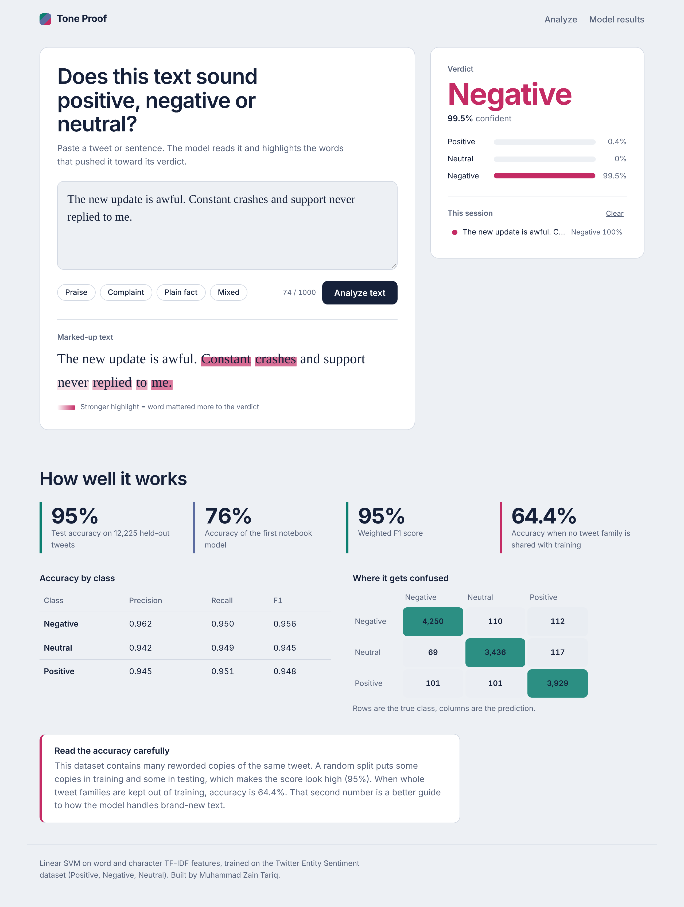
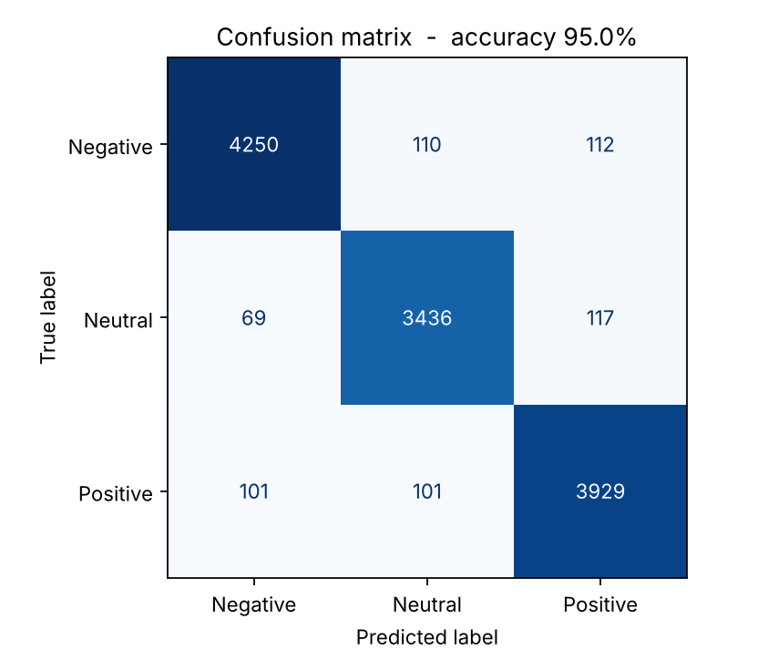
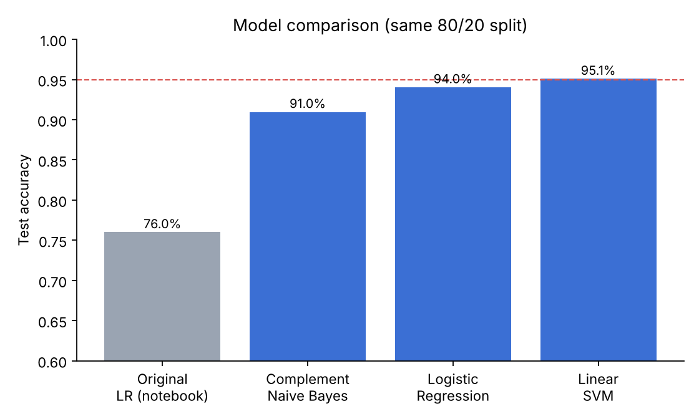

# Multi-Class Sentiment Analysis (NLP)

Classify tweets and short texts as **Positive**, **Negative** or **Neutral**, and see *which words* drove the decision. The project covers the full workflow: data preparation, feature engineering, model comparison, evaluation, and a web app for live predictions.



## Highlights

- **95.0% test accuracy** (weighted F1 0.950) on the same 80/20 split used in the original notebook, up from 76%.
- **Explainable predictions**: the web app marks up the input text so you can see which words pushed the verdict.
- **Calibrated probabilities**: every prediction comes with a real confidence score for each class, not a raw SVM margin.
- **Honest evaluation**: results are reported under a strict split as well, because this dataset contains many near-duplicate tweets (see [Evaluation](#evaluation-and-an-important-caveat)).
- **One-command retraining**: `python -m src.train` rebuilds the model, metrics and charts.

## Results

| Model | Accuracy (80/20 split) |
|---|---|
| Logistic Regression, original notebook | 76% |
| Complement Naive Bayes | 91.0% |
| Logistic Regression | 94.0% |
| Linear SVM | 95.1% |
| **Final: Linear SVM + probability calibration** | **95.0%** |

Per-class results for the final model (12,225 test tweets):

| Class | Precision | Recall | F1 |
|---|---|---|---|
| Negative | 0.962 | 0.950 | 0.956 |
| Neutral | 0.942 | 0.949 | 0.945 |
| Positive | 0.945 | 0.951 | 0.948 |

| Confusion matrix | Model comparison |
|---|---|
|  |  |

### Evaluation and an important caveat

The Twitter Entity Sentiment dataset contains many reworded copies of the same tweet. With a random train/test split, copies of one tweet land on both sides, so the score is higher than it would be on genuinely new text.

| Evaluation | Accuracy |
|---|---|
| Random 80/20 split (same protocol as the original notebook) | **95.0%** |
| Strict split: all copies of a tweet kept together | **64.4%** |
| Official `twitter_validation.csv` | 99.0% (52% of its texts also appear in training, so this is not independent) |

The 95% figure is a fair comparison with the original 76% because both use the same split. The 64.4% figure is the better guide to how the model handles brand-new text. Closing that gap would need a pretrained language model such as BERT or RoBERTa, which is listed under [Future work](#future-work).

## How it works

```
Raw text -> normalise -> word 1-3-grams + character 2-5-grams (TF-IDF) -> Linear SVM -> calibrated probabilities
```

What changed from the first version, and why it helped:

| Change | Reason |
|---|---|
| Keep stopwords | Words like "not", "no" and "never" carry sentiment |
| Character n-grams | Handle misspellings, slang and emoji-like text |
| Word n-grams up to 3 | Capture short phrases such as "not good at all" |
| Sublinear TF-IDF | Stops repeated words from dominating a text |
| Probability calibration (5-fold) | Gives meaningful confidence scores for the UI |
| Tuned `C` for the SVM | Small but measurable accuracy gain |

The word-level highlights use leave-one-word-out influence: each word is removed in turn, and the drop in the predicted class's probability shows how much that word mattered.

## Project structure

```
multiclass-sentiment-analysis-nlp/
├── app/
│   ├── app.py                 Flask server and /api endpoints
│   ├── templates/index.html   Web UI
│   └── static/                CSS and JavaScript
├── src/
│   ├── preprocess.py          Text normalisation
│   └── train.py               Training and evaluation script
├── assets/
│   ├── models/
│   │   ├── sentiment_model.pkl   Final model (vectoriser + classifier)
│   │   ├── model.pkl             Original Logistic Regression
│   │   └── tfidf.pkl             Original TF-IDF vectoriser
│   ├── notebooks/             Original exploration notebook
│   └── reports/               Project reports (PDF)
├── data/                      twitter_training.csv, twitter_validation.csv
├── results/                   metrics.json and charts
├── docs/                      README screenshot
└── requirements.txt
```

## Getting started

**Requirements:** Python 3.10 or newer.

```bash
git clone https://github.com/<your-username>/multiclass-sentiment-analysis-nlp.git
cd multiclass-sentiment-analysis-nlp

python -m venv .venv
# Windows: .venv\Scripts\activate      macOS/Linux: source .venv/bin/activate
pip install -r requirements.txt
```

### Run the web app

```bash
python -m app.app
```

Open http://localhost:5000, paste some text and select **Analyze text**.

### Retrain the model (optional)

Place `twitter_training.csv` and `twitter_validation.csv` in `data/` (download from [Kaggle](https://www.kaggle.com/datasets/jp797498e/twitter-entity-sentiment-analysis)), then run:

```bash
python -m src.train
```

This writes the model to `assets/models/sentiment_model.pkl` and updates `results/`. Training takes a few minutes on a laptop.

## API

`POST /api/predict`

```json
{ "text": "The new update is awful. Constant crashes." }
```

Response (shortened):

```json
{
  "label": "Negative",
  "confidence": 0.97,
  "probabilities": { "Negative": 0.97, "Neutral": 0.00, "Positive": 0.03 },
  "tokens": [{ "t": "Constant", "w": 0.052, "space": false }]
}
```

`GET /api/metrics` returns the evaluation results shown in the app.

## Dataset

[Twitter Entity Sentiment Analysis](https://www.kaggle.com/datasets/jp797498e/twitter-entity-sentiment-analysis) from Kaggle: tweets about brands, games and companies, labelled Positive, Negative, Neutral or Irrelevant. The `Irrelevant` class is removed, leaving 61,121 training tweets across three classes.

## Limitations

- Accuracy on text unlike the training tweets is much lower than the headline figure (about 64% on the strict split).
- Plain factual statements can be misread. For example, "The package arrived on Tuesday." may be labelled Negative.
- The model was trained on English tweets about brands and games, so other domains such as product reviews or news may perform worse.
- Sarcasm and mixed opinions are not handled reliably.

## Future work

- Fine-tune a transformer (BERT, RoBERTa) and compare it on the strict split.
- Remove near-duplicate tweets before splitting and report cross-validated results.
- Add batch prediction from CSV files.
- Deploy the app (Render, Hugging Face Spaces or Docker).

## Tech stack

Python, scikit-learn, pandas, joblib, Matplotlib, Flask, HTML/CSS/JavaScript.

## Author

**Muhammad Zain Tariq**, BS Computer Engineering

The original project reports are in [`assets/reports/`](assets/reports/).
